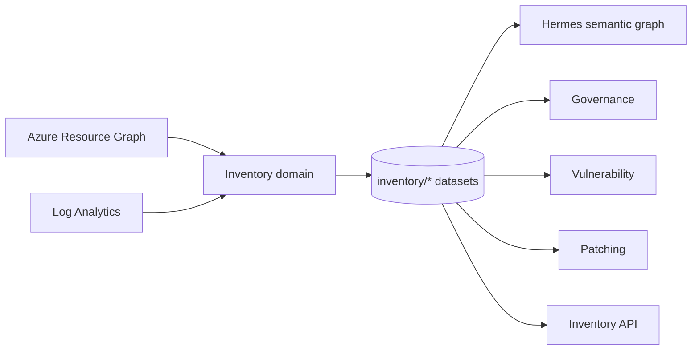

# Phase 7 Research: Unified Resource Inventory

Scope: extend inventory beyond OS + installed software (Phase 6) to cover PaaS and other
resource families, and **relocate inventory ownership out of the Hermes ARG connector**,
so the platform has one authoritative inventory domain that Hermes and every other
subsystem consume.

**Architectural principle (from review): Hermes must never manage inventory. Hermes is a
consumer of inventory.**

---

## 1. What exists today

### 1.1 PaaS is already ingested

`QueryCatalog.build()` issues a broad `Resources | project id, name, type, tenantId,
subscriptionId, resourceGroup, location, tags, properties` query.
`_entity_type_for_resource()` (`normalize.py:863`) classifies rows into three buckets:

| ARM type | Entity family |
|---|---|
| `microsoft.compute/virtualmachines` | `VirtualMachine` |
| `microsoft.hybridcompute/machines` | `ArcServer` |
| *everything else* | `Resource` |

Every App Service, SQL DB, Storage Account, AKS cluster, Key Vault and Cosmos account
already lands in `entities/Resource`. **There is no acquisition gap for PaaS** — only a
projection, ownership, and read-model gap.

### 1.2 Inventory ownership is currently inside Hermes — the core defect

Today the ARG connector owns the entire inventory lifecycle:

| Concern | Current owner | Location |
|---|---|---|
| OS acquisition | Hermes | `queries.py:_inventory_specs()` |
| Software acquisition (LAW) | Hermes | `service.py:_fetch_software_inventory()` |
| OS normalization | Hermes | `normalize.py:_normalize_inventory()` (line 217) |
| Software normalization | Hermes | `inventory_normalize.py` |
| Retention on failed refresh | Hermes | `service.py:107-117` |
| Source-status computation | Hermes | `service.py:121-122` |
| Publication | Hermes | `storage.py:90-101` |
| Read model | Inventory domain | `intelligence/inventory/service.py` |

The dependency is also **already inverted**: `hermes_arg_connector/inventory_normalize.py`
imports `MachineObservation` and `SoftwareObservation` *from* `intelligence.inventory.models`.
Hermes both owns the inventory pipeline and depends on the inventory domain's contracts.

Consequences observed in this session:
- Inventory availability is coupled to a Hermes sync run — the origin of the `503
  provider_unavailable` on the Software Inventory page.
- Inventory datasets ride inside `NormalizedGraph` (`normalize.py:60-63`) as four bolt-on
  fields, published via `getattr(graph, ...)` guards in `storage.py` — a structural sign
  they do not belong to the graph.
- Adding a PaaS family today means editing the graph dataclass, the normalizer, the
  connector service, and the storage publisher — four Hermes files for a non-Hermes concern.

### 1.3 Read model

- `models.py` — `MachineObservation` (VM/Arc-specific: `image_publisher`, `image_sku`,
  `computer_name`, `machine_status`) and `SoftwareObservation`. Frozen dataclasses with
  strict validation. Shared primitives that already generalize: `InventoryEvidence`,
  `InventorySourceStatus`, `InventoryNarrativeCitation`, `SOURCE_STATES`.
- `service.py` — `InventoryService.from_store()` reads exactly four datasets and returns
  `None` if all four are empty (line 214). All-or-nothing availability.
- `api/routers/inventory.py` — seven scope-enforced, evidence-enveloped routes.

### 1.4 Consumers — the opportunity

`read_dataset()` has only **14 call sites**. Critically,
`src/intelligence/{governance,vulnerability,lifecycle,predeploy,change,patch}` contain
**zero** dataset reads. None have an inventory dependency yet. The single source of truth
can be established *before* six subsystems each grow their own resource-listing logic.

---

## 2. Problems with extending as-is

1. **Ownership is backwards.** Hermes manages inventory; correcting this is prerequisite
   to everything else, because each new family otherwise deepens the coupling.
2. **`MachineObservation` cannot represent PaaS.** Required `machine_name`/`os_name`/
   `os_version` and `MACHINE_SOURCE_TYPES = {azure_vm, arc}` are hard validation errors
   for an App Service.
3. **`group_key()` is `os_name|os_version`** — meaningless for PaaS, where grouping is by
   resource type / SKU / tier / runtime version.
4. **`SOURCE_TYPES` is a closed frozenset** that four validators depend on.
5. **Family-specific dataset naming** means every family adds `from_store` reads and
   lengthens the emptiness check.
6. **All-or-nothing availability.** One missing family should degrade, not blank the
   capability — the principle the ARG query split already honors ("a partially observed
   estate is reported as partial, never as an estate with no firewall").

---

## 3. Proposed design

### 3.1 Invert ownership: an independent inventory domain

Move acquisition, normalization, retention, status, and publication into
`src/intelligence/inventory/`, leaving Hermes as a pure consumer.

```
src/intelligence/inventory/
  sources/            # owns its own acquisition
    arg.py            # ARG queries for OS + PaaS
    logs.py           # LAW ConfigurationData for software
  normalization/      # moved from hermes_arg_connector/inventory_normalize.py
  registry.py         # InventoryFamily registry
  pipeline.py         # acquire -> normalize -> retain -> status -> publish
  models.py           # ResourceObservation + specializations
  service.py          # read model (unchanged contract)
```

Target dependency direction:



Hermes reads `inventory/*` to enrich its graph. It never writes it. Both remain
independently runnable: **inventory can refresh without a Hermes sync**, which directly
removes the coupling behind the current 503.

Shared infrastructure (`DatasetStore`, generation/pointer/hash machinery in `storage.py`)
should be extracted to a neutral module rather than imported from `hermes_arg_connector`,
so the inventory domain does not depend on Hermes for publication either.

### 3.2 Generalize to `ResourceObservation`

Added alongside existing models, not replacing them:

```python
@dataclass(frozen=True)
class ResourceObservation:
    resource_id: str            # ARM id — the universal join key
    display_name: str
    resource_type: str          # microsoft.web/sites
    family: str                 # compute | paas | data | network | identity
    subscription_id: str
    resource_group: str
    location: str
    environment: str
    sku: str = ""
    tier: str = ""
    runtime: str = ""           # "python|3.11", "SQL 2019"
    runtime_version: str = ""
    provisioning_state: str = ""
    observed_at: str = ""
    source_type: str = ""
    source_status: str = ""
    evidence: tuple[InventoryEvidence, ...] = ()
    query_version: str = ""
    attributes: dict[str, str] = field(default_factory=dict)  # per-family, never raw payload
```

`MachineObservation` becomes a specialization carrying OS fields; its API contract and
`to_dict()` stay byte-identical so Phase 6 behavior is preserved.

### 3.3 Open the family registry

```python
@dataclass(frozen=True)
class InventoryFamily:
    name: str                       # "os" | "software" | "paas"
    dataset: str                    # "inventory/paas_observations"
    status_dataset: str             # "inventory/paas_source_status"
    source_types: frozenset[str]
    group_key: Callable[[Mapping], str]
    observation: type
    acquire: Callable[..., Sequence[Mapping]]   # family owns its own source
```

`SOURCE_STATES` stays global (genuinely universal). `SOURCE_TYPES` becomes the computed
union of registered families instead of a hardcoded frozenset.

### 3.4 Per-family availability

```python
present = {name: v for name, v in loaded.items() if v is not None}
if not present:
    return None            # unchanged: no inventory at all -> 503
return cls(snapshot, available_families=set(present))
```

`/inventory/paas` then 503s only when the PaaS family is missing, while `/inventory/os`
keeps serving — matching the existing per-family failure-isolation principle.

### 3.5 PaaS acquisition

- **(a) Project from the generic `Resources` query** the inventory domain now issues
  itself. Zero extra ARG cost, immediately covers every PaaS type; `properties` is
  retained so SKU/tier/runtime are extractable.
- **(b) Targeted `_paas_specs()`** mirroring `_network_specs()`, one QuerySpec per family
  (`microsoft.web/sites`, `microsoft.sql/servers/databases`,
  `microsoft.storage/storageaccounts`, `microsoft.containerservice/managedclusters`,
  `microsoft.keyvault/vaults`, `microsoft.documentdb/databaseaccounts`), projecting
  SKU/tier/runtime explicitly.

**Recommendation: (a) for breadth, (b) where lifecycle matters** — App Service runtimes,
SQL versions, AKS versions are the highest-value PaaS EOL signals and reuse the Phase 6
`EOLReviewService` machinery directly.

### 3.6 API surface

Additive, mirroring existing OS routes:

```
GET /api/v1/inventory/paas                  grouped by resource_type|sku
GET /api/v1/inventory/paas/{key}            drill-down
GET /api/v1/inventory/paas/{key}/lifecycle  reuse EOLReviewService
GET /api/v1/inventory/resources             cross-family flat view (the SoT read)
GET /api/v1/inventory/resources/{id}        everything known about one ARM id
```

The last two make it a genuine single source of truth: one scope-enforced,
evidence-enveloped answer to "what is in this scope?".

### 3.7 Internal read port

```python
class InventoryReadPort(Protocol):
    def resources(self, scope: Scope, *, family: str | None = None,
                  resource_type: str | None = None) -> tuple[ResourceObservation, ...]: ...
    def resource(self, scope: Scope, resource_id: str) -> ResourceObservation | None: ...
```

Highest-leverage item in the proposal. **Hermes consumes inventory through this port**,
as do governance, vulnerability, patch, predeploy, change, and lifecycle — which have no
dataset reads today. Defining it now prevents seven divergent implementations later.

---

## 4. Migration path (no breaking changes)

| Step | Change | Risk |
|---|---|---|
| 1 | Extract `DatasetStore`/generation machinery to a neutral module | low — pure move, wide test coverage |
| 2 | Move `inventory_normalize.py` + `_normalize_inventory()` into the inventory domain | low — fixes the existing inverted import |
| 3 | Move OS/software acquisition (`_inventory_specs`, `_fetch_software_inventory`) into `inventory/sources/` | medium — touches the sync path |
| 4 | Inventory publishes its own `inventory/*` datasets; drop the four bolt-on `NormalizedGraph` fields | medium — dataset names and contents unchanged |
| 5 | Hermes reads `inventory/*` as a consumer | low |
| 6 | Add `ResourceObservation` + family registry | none — pure addition |
| 7 | Per-family availability in `from_store` | low — same `None` when all empty |
| 8 | Add PaaS family (option a) | low — new dataset |
| 9 | Add `/inventory/paas` + `/inventory/resources` routes | none — additive |
| 10 | Define `InventoryReadPort`; migrate Hermes first, then other consumers | low |
| 11 | Optional: targeted `_paas_specs()` for runtime precision | medium — new ARG queries, cost/throttle review |

Steps 1-5 are the ownership inversion and must precede family expansion — otherwise each
new family deepens the coupling being removed. Existing coverage
(`tests/test_inventory_provider.py`, `tests/test_inventory_mapping.py`,
`tests/test_incremental_sync.py`) guards the moves, since dataset names and row shapes
are unchanged throughout.

Behavior to preserve explicitly during step 3-4: the failed-refresh retention rule
(`service.py:107-117`) — a failed refresh must not turn previously published inventory
into an unqualified empty success.

---

## 5. Recommendation

Treat this as a **new roadmap phase**, not an extension of Phase 6 (already verified,
awaiting only manual/authenticated walkthroughs). Suggested framing:

> **Phase 7: Unified Resource Inventory** — Establish inventory as an independent domain
> that owns its own acquisition, normalization, and publication; generalize the read model
> to all Azure resource families including PaaS; and expose one scope-enforced inventory
> contract that Hermes and every other subsystem consumes instead of re-deriving resource
> lists.

Sequence discipline: **ownership inversion (steps 1-5) before family expansion (steps
6-11)**, so the first new family lands on a correctly-owned, generalized foundation.

### Immediately actionable, independent of the phase
The current 503 has a real remedy the UI now describes: run
`uv run hermes-arg sync --config config.yaml` to generate the first inventory datasets.
Step 4 removes that Hermes dependency entirely; step 7 additionally stops a missing
software family from blanking OS inventory.

---

## 6. Entry gate and blast radius (added after review)

### 6.1 Is Phase 6 complete?

**Code-complete and automated-green; not signed off.**

| Dimension | State |
|---|---|
| Plans | 9/9 executed, 9/9 summaries |
| Contract truths | 6/6 VERIFIED |
| Automated gates | PASS (lint, focused suites, production build) |
| Verification status | `human_needed` (was `gaps_found`, now closed) |
| UAT | **No `06-UAT.md` exists — never run** |

Five residual items are explicit human checks, all requiring live Azure/provider
credentials rather than code changes:

1. Authenticated Azure walkthrough — ARG permissions, server-owned LAW workspace
   mappings, Entra Logs Query permission, real freshness/evidence/joins, provider
   outage and partial states.
2. EOL citation review — unmapped OS, candidate inspection, explicit persistence,
   stale-revision response.
3. External-provider configuration — `APPROVED_SEARCH_API_ENDPOINT` /
   `APPROVED_SEARCH_API_KEY`; `provider_not_configured` must stay visible until then.
4. Foundry narrative walkthrough — narration separated from facts/citations, and the
   fact-only fallback warning.
5. Browser UX/accessibility — responsive layout, keyboard drill-down, badge contrast,
   real CSV download.

Also open: one unrelated pre-existing failure in `web/src/app/compliance/page.test.tsx`
(`deferred-items.md`), untouched by Phase 6.

### 6.2 Why this matters for Phase 7

Every one of those five items exercises **exactly the pipeline Phase 7 relocates**:
acquisition, normalization, source status, retention, publication. Starting Phase 7
first would mean:

- **Unverified baseline.** No confirmed-good live behavior to diff against. If the
  authenticated walkthrough later fails, it is ambiguous whether Phase 6 was wrong or
  Phase 7's move broke it.
- **Moving target for UAT.** The five walkthroughs would have to be redone after the
  refactor, so the cost is paid twice.
- **Automated tests do not cover the risk.** 79 inventory/sync tests pass, but all use
  fixtures. The residual items are precisely the live-credential paths fixtures cannot
  reach — real ARG throttling, real LAW permission failures, real partial states.

### 6.3 Measured blast radius — REVISED 2026-08-26

> **Correction.** The figures below ("53 files import `hermes_arg_connector`") measure
> *module* coupling, not *inventory* coupling, and materially overstate Phase 7's true
> surface. Re-measured against actual inventory usage, the affected surface is **an order
> of magnitude smaller**. See the revised table.

**Original (module-level, overstated):** 53 files import `hermes_arg_connector`; 15
import `DatasetStore`; 10 import `intelligence.inventory`.

**Revised (inventory-level, measured):** every site that actually touches inventory data:

| Site | Role | Phase 7 action |
|---|---|---|
| `intelligence/inventory/service.py:210-213` | reads all 4 `inventory/*` datasets | becomes the owner; reads move behind the read port |
| `intelligence/inventory/service.py:621` | `source_table` label | update with dataset naming |
| `intelligence/inventory/narrative.py:25` | approved source allow-list | extend for new families |
| `hermes_arg_connector/storage.py:91-99` | **publishes** all 4 datasets | relocate to inventory domain |
| `hermes_arg_connector/service.py:116` | reads software obs for retention rule | **the only true cross-domain consumer read** |
| `hermes_arg_connector/normalize.py` | OS normalization + bolt-on graph fields | relocate |
| `hermes_arg_connector/inventory_normalize.py` | software normalization | relocate wholesale |
| `api/routers/inventory.py`, `api/runtime.py` | wiring | repoint to read port |
| 4 test files | fixture-bound coverage | update with contract |

**The key finding: there is no sprawl of inventory consumers to migrate.** Outside the
inventory domain itself, exactly **one** cross-domain read of an `inventory/*` dataset
exists — `hermes_arg_connector/service.py:116`, and it exists only to implement the
failed-refresh retention rule. `intelligence/{governance,vulnerability,lifecycle,predeploy,change,patch}`
still have zero dataset reads (§1.4).

**Why this lowers the risk of the waiver.** The concern in §6.6 was a 53-file refactor
without a baseline. The real refactor is ~8 source files, of which 3 are the Hermes
inventory files being relocated wholesale rather than rewritten. Wholesale relocation
with unchanged dataset names and row shapes is far more amenable to characterization
testing than a broad rewrite. The waiver's accepted risk is correspondingly smaller than
first stated — though not zero, since the relocated code still changes *when* and *by
whom* it runs.

**What stays genuinely risky.** Not the file count, but three specific behaviors:

1. **The retention rule** (`service.py:107-117`) — subtle, load-bearing, and the one
   place where publication order and read order interact. It must survive the move.
2. **Publication timing** — inventory currently publishes as a side effect of a graph
   sync. Making it publish independently changes *when* datasets appear, which the
   all-or-nothing `from_store()` check at `service.py:214` is implicitly coupled to.
3. **`_preserve_created_timestamps` / `_preserve_source_watermarks`** (`service.py:123-124`)
   — cross-cutting graph-level machinery that inventory currently rides along with and
   will need its own equivalent of.

These three, not the import count, are what characterization tests must pin.

**Original module-level counts, retained as record:**

| Surface | Count | Bearing on Phase 7 |
|---|---|---|
| Files importing `hermes_arg_connector` | 53 | mostly unrelated to inventory; overstates scope |
| Files importing `DatasetStore` | 15 | relevant only to the step-1 storage extraction |
| Files importing `intelligence.inventory` | 10 (6 src, 4 tests) | the accurate proxy |
| Files actually reading/writing `inventory/*` | **6 src, 4 tests** | the real surface |
| Cross-domain inventory dataset reads | **1** (`service.py:116`) | the real coupling |
| Passing inventory/sync tests as the guard | 79 | fixture-bound |

Step 1 (extract `DatasetStore`/generation machinery) is the one step whose reach is
genuinely wide, because 15 files depend on that class. Steps 2-4 (move normalization,
move acquisition, re-home publication) are confined to the inventory files listed in the
revised table above. The earlier claim that this is "the highest-coupling refactor
proposed for this codebase" holds only for step 1, and only if the extraction changes
`DatasetStore`'s public surface — which it should not.

### 6.4 Recommended entry gate — SUPERSEDED (waived 2026-08-26)

> **Status: WAIVED by operator decision.** The gate below was the pre-review
> recommendation. The operator waived it on the grounds that Phase 7 relocates the very
> pipeline this UAT would exercise, so a pre-Phase-7 run is largely disposable. Phase 6
> UAT is **deferred, not cancelled** — it moves into Phase 7's exit criteria and is paid
> once against the final pipeline. The original reasoning is retained below as record;
> see §6.6 for what replaces it.

Do not begin Phase 7 until:

1. **Phase 6 UAT is run** (`gsd-verify-work 6`) and the five residual walkthroughs are
   recorded pass/fail against live Azure.
2. **A known-good live baseline is captured** — real source freshness, evidence, exact
   joins, and at least one observed partial/outage state — so post-refactor behavior can
   be diffed rather than re-litigated.
3. **The compliance test failure is triaged**, so full-suite green is a usable signal
   during a 53-file-blast-radius refactor.

Gate 1 is the hard prerequisite. Gates 2-3 are strongly recommended.

### 6.5 Lower-risk alternative if Phase 6 sign-off is blocked — NOT TAKEN

> **Status: not taken.** The 7a/7b split existed solely to de-risk starting before Phase 6
> sign-off. With the gate waived, the split adds a relocation cost for no offsetting
> benefit, so the operator elected the full Phase 7 path. Retained as record.

If live Azure access is not available soon, Phase 7 can be split so value lands without
the risky move:

- **7a (low risk, no ownership change):** `ResourceObservation` + family registry +
  per-family availability + PaaS projected from the existing `entities/Resource`
  publication. Purely additive; Hermes still publishes. Delivers PaaS inventory and
  fixes the all-or-nothing 503 behavior.
- **7b (high risk, gated on Phase 6 sign-off):** the ownership inversion — extract
  shared storage, move normalization and acquisition, re-home publication.

This ordering contradicts the "ownership inversion first" sequencing note in §4, and is
a deliberate trade: 7a adds one family under the current ownership, which 7b must then
relocate. That is a bounded, known cost — a second pass over one registered family —
and is preferable to performing a 53-file refactor against an unverified baseline.

### 6.6 Operating decision (2026-08-26) — what replaces the gate

**Decision:** proceed with full Phase 7 immediately. No Phase 6 UAT beforehand. Refactor
all affected consumers, including the Hermes side, to use the unified inventory.

**What the waiver costs.** §6.2 argued the residual Phase 6 items exercise precisely the
acquisition / normalization / status / retention / publication pipeline Phase 7 relocates.
That argument cuts both ways, and the operator's reading is the stronger one: verifying a
pipeline that is about to be dismantled validates code with a short remaining life. The
real cost is not the lost verification — it is the **lost baseline**. Without a live
reference, a regression discovered after the refactor cannot be attributed: it may be
newly introduced or may have been broken in Phase 6 all along.

**What replaces it.** Empirical comparison is unavailable, so the regression net becomes
contract-level and must be built first:

1. **Characterization tests are a hard precondition for migration step 1.** Before any
   code moves, pin the observable contract against fixtures: dataset names, row shapes,
   `group_key()` behavior, source-status transitions, evidence fields, pagination, and
   the failed-refresh retention rule (`service.py:107-117`). These tests must pass
   unchanged after every migration step. This is the *only* thing standing between a
   53-file refactor and silent behavior drift.
2. **Preserve the wire contract exactly.** Dataset names and row shapes do not change
   during inversion. Generalization to `ResourceObservation` is additive; OS and software
   rows keep their existing shapes.
3. **Migrate consumers last.** The read port must be stable and characterized before the
   53 `hermes_arg_connector` importers and 10 `intelligence.inventory` importers are
   pointed at it.
4. **Phase 6 verification becomes Phase 7 exit criteria.** The six deferred walkthroughs
   plus windows #9-#13 close under Phase 7, against the new pipeline, once.

**Revised sequence:** characterize → extract → invert → expand → migrate consumers.

Step 0 (characterize) is new and non-negotiable under the waiver. Without it this phase
has no regression signal at all, since the existing 79 tests are fixture-bound and were
written against the current structure rather than against the contract.

---

## 7. Scope expansion: inventory as the system-wide acquisition layer (2026-08-26)

**Operator direction:** Hermes must pivot to use unified inventory as its source for
discovery and semantic modelling rather than calling ARG directly. Unified inventory must
support whatever Hermes needs. Web and API must likewise pivot to unified inventory to
power the UI.

This is a materially larger scope than §1-§6, which treated inventory as a *read model*
that happened to be owned by the wrong module. The direction above makes inventory the
**acquisition layer for the entire system**. §7 records what that actually implies,
including where it should stop.

### 7.1 What Hermes queries today — inventory is a small slice

`queries.py:build()` issues ~20 ARG query specs. Only two are inventory
(`_inventory_specs()`). The rest:

| Group | Specs | ARG table |
|---|---|---|
| Core resources | `resources`, `resource_containers`, `management_groups` | Resources, ResourceContainers |
| Change feed | `resource_changes` | ResourceChanges |
| Telemetry | `monitor` | InsightsMetrics |
| Health | `service_health` | HealthResources |
| Security | `defender`, `vulnerability` | SecurityResources |
| Policy | `policy` | PolicyResources |
| Patch | `patch_assessments`, `patch_assessment_details`, `patch_installations` | PatchAssessment/InstallationResources |
| Advisor | `advisor_recommendations` | AdvisorResources |
| Identity | `_identity_specs()` | role assignments/definitions, managed identities |
| Network | `_network_specs()` | network topology |
| **Inventory** | **`_inventory_specs()`** | **Resources (VM/Arc) + LAW ConfigurationData** |

`ENTITY_TYPES` spans 14+ entity types. **Inventory is roughly 10% of what Hermes
acquires.**

### 7.2 The critical distinction: resource identity vs. resource assessments

Not everything Hermes queries is inventory, and conflating them would produce a god
module that is worse than today's coupling.

- **Resource identity/existence** — what resources exist, their type, SKU, location,
  tags, OS, installed software, containment. *This is inventory.* Multiple ARG tables
  answer it (`Resources`, `ResourceContainers`), and today Hermes re-derives it
  independently of the inventory pipeline.
- **Assessments/observations about resources** — patch compliance, vulnerabilities,
  policy state, advisor recommendations, metrics, health. *This is not inventory.* These
  are time-varying judgements *about* inventory items, correctly owned by their own
  domains.
- **Relationships/topology** — network paths, identity grants, containment edges. *This
  is semantic modelling* — Hermes's actual job, and what it should keep.

**Recommended boundary:** inventory owns the **resource identity plane** — the answer to
"what exists, of what kind, where, with what attributes." Every other domain owns its own
assessment plane and *joins* to inventory by resource ID.

This directly serves the operator's intent — Hermes stops calling ARG for resource
identity and consumes inventory instead — without making inventory responsible for
Defender findings or advisor recommendations, which would recreate the ownership problem
in reverse.

### 7.3 What Hermes needs from inventory to stop querying ARG for identity

Derived from `normalize.py` usage, `_entity_type_for_resource()`, and the relationship
builders:

1. **Complete resource enumeration** in scope — not just VM/Arc. Already available; ARG
   `Resources` is queried in full today.
2. **Containment hierarchy** — management group → subscription → resource group →
   resource. Currently from `ResourceContainers`; inventory must carry it or Hermes keeps
   a second acquisition path for it alone.
3. **Full raw property bag per resource.** Hermes's normalizers and network/identity
   modelling read deeply into `properties`. If inventory projects a lossy subset, Hermes
   cannot pivot. **This is the single most likely blocker.** `ResourceObservation` must
   either retain raw properties or expose a passthrough.
4. **Tags, location, type, SKU/tier, tenant/subscription/RG** — for grouping and modelling.
5. **Change/watermark semantics** — `resource_changes` drives incremental sync, and
   `_preserve_source_watermarks` depends on it. Inventory must expose freshness and
   watermarks per family or incremental sync regresses to full refresh.
6. **Stable identity + dedupe** — Hermes joins across tables by resource ID; `group_key()`
   semantics must generalize beyond machines.

**Risk:** requirements 3 and 5 mean the inventory contract must be near-lossless for the
identity plane. A "clean" narrow `ResourceObservation` would force Hermes to keep its own
ARG path, defeating the pivot. Design the contract from Hermes's real read patterns, not
from what the inventory UI happens to display.

**Measured evidence this risk is real, not theoretical.** `properties` is referenced 32
times in `normalize.py` and 43 times in `network_normalize.py`. The access is not flat
field-picking — it descends into nested structures and re-stores raw sub-bags. Example
(`network_normalize.py:156-161`), building subnets:

```python
"delegations": [
    _text((item.get("properties") or {}).get("serviceName"))
    for item in _list(subnet_props.get("delegations"))
    ...
],
"properties": subnet_props,   # raw nested bag retained wholesale
```

Hermes reads `properties.subnets[].properties.delegations[].properties.serviceName` —
four levels deep — and then persists `subnet_props` verbatim. The same pattern recurs for
`virtualNetworkPeerings`. Any projection that flattens, whitelists, or type-narrows
`properties` breaks network and identity modelling.

**Design implication:** `ResourceObservation` must carry `properties` as an opaque
passthrough, and the typed inventory fields (OS, SKU, tier) should be *derived
projections alongside it*, never a replacement for it. Verify this against
`normalize.py`, `network_normalize.py`, and `_identity_specs()` consumers before
finalizing the contract.

### 7.4 API and web pivot — cheaper than it looks

The API already has the right seam: `runtime.py` registers providers via `ProviderSpec`
(`inventory` at line 1075, alongside `governance`, `patching`, `network`, `vulnerability`,
`semantic_graph`). Routers depend on providers, not datasets — confirmed: **no router
reads `read_dataset` or `entities/` directly**; only `runtime.py` does the wiring.

Consequence: **the API pivot is mostly a wiring change**, not a router rewrite. Point the
resource-identity-shaped providers at the inventory read port and leave route handlers
alone. The web layer consumes API routes, so if route contracts hold, **most web pages
need no change at all**.

The exception is `agent_queries.py`, which reads `entities/VirtualMachine`,
`entities/ArcServer`, and `entities/PatchAssessment` directly (lines 35, 41, 49, 70, 81).
Its server/VM reads are exactly the identity plane and should move to the inventory read
port; its `PatchAssessment` reads should stay with the patch domain.

Pages likely affected: `software-inventory` (already), plus any of `services`, `search`,
`investigate`, `twin`, `changes` that surface resource identity. These need auditing at
plan time, not assumption.

### 7.5 Honest scope assessment

§7 is **not one phase**. Realistic decomposition:

| Stage | Scope | Risk |
|---|---|---|
| **7** (as planned) | Ownership inversion, PaaS family, per-family availability, read port | Medium — contained, characterizable |
| **8** | Inventory owns the full resource identity plane (all types, containment, raw properties, watermarks); Hermes drops ARG identity queries and consumes inventory | **High** — touches core normalization and incremental sync |
| **9** | API providers + `agent_queries` repoint to the read port; web audit | Low-medium — provider seam already exists |

Attempting all three as one phase would mean simultaneously inverting ownership,
redefining the resource contract, and rewiring every consumer, with **no verified live
baseline** (§6.6). That is the failure mode the Phase 6 gate was meant to prevent, and
waiving the gate makes staging *more* important, not less.

**Recommendation:** keep Phase 7 as currently scoped. Add Phases 8 and 9 for the identity
plane and the consumer pivot. Phase 7's read port is the contract both later phases depend
on — getting it right, with characterization tests, is what makes them tractable.

### 7.6 Open questions for planning

1. Does `ResourceObservation` carry raw `properties` verbatim? (If no, the Hermes pivot
   cannot complete — see §7.3.3.)
2. Does inventory own containment (`ResourceContainers`), or does Hermes keep it?
3. How do inventory freshness/watermarks compose with Hermes's incremental sync?
4. Do assessment domains (patch/vuln/policy/advisor) join to inventory by ID, or keep
   their own resource projections?
5. Does the semantic graph still publish `entities/*` for identity types, or do those
   become views over inventory? (Determines whether `agent_queries` changes shape or just
   source.)
