# Phase 13 Discovery Review

## Review Outcome

The platform already has most of the deterministic ontology construction and
Fabric publication machinery required for autonomous operation. The missing
capability is not another graph builder. It is a durable orchestration and
governance boundary that:

1. detects due or changed evidence without a browser;
2. asks a Foundry agent only for bounded relationship proposals;
3. validates and reviews those proposals deterministically; and
4. publishes a fenced, versioned ontology generation through a separate writer.

The recommended Foundry implementation is a **code-first prompt agent**, not a
hosted agent, for the first production slice. The repository already provisions
and invokes prompt agents through governed MCP tools, while scheduling,
concurrency, state, validation, and publication belong in deterministic
application code. A hosted agent should be reconsidered only if the phase proves
that agent-owned multi-step orchestration or custom protocols are necessary.

Microsoft's current guidance supports this split: prompt agents are intended for
managed production agents without custom runtime logic, while hosted agents are
for custom code and orchestration. Both support dedicated Entra identity,
versioning, tracing, evaluation, and governed MCP tools.

Reference: <https://learn.microsoft.com/azure/foundry/agents/overview>

## Current Discovery and Publication Flow

### 1. Manual trigger and process ownership

- The web connections page initiates Sync from
  `web/src/app/connections/page.tsx`.
- `src/api/routers/connections.py` accepts the request and delegates to the
  onboarding service.
- `src/onboarding/service.py` owns process-local background execution and sync
  status projection.
- `src/onboarding/sync.py::ConnectionSyncCoordinator` runs connection-scoped
  ingestion, then invokes a publish factory that merges inventory, rebuilds the
  ontology, and writes Fabric tables.
- `src/onboarding/runtime.py` constructs the ingestion and publication
  dependencies used by the route.

This makes the normal refresh lifecycle dependent on a user click and an API
replica remaining alive. It is unsuitable as the only production scheduler.

### 2. Entity and relationship discovery

- Inventory and Azure evidence are normalized by
  `src/onboarding/graph_normalize.py::Normalizer`.
- Nested network resources are expanded by
  `src/onboarding/network_normalize.py`.
- Canonical ontology entities are built by
  `src/ontology/entity_builder.py`.
- `src/ontology/relationship_builder.py` deterministically derives containment,
  operational, topology, connection-metadata, and tag-derived relationships.
- `src/ontology/confidence.py` centralizes source-specific confidence.
- Incremental row hashes exist in `NormalizedGraph.row_hashes`, but callers do
  not yet form a durable end-to-end incremental checkpoint and reconciliation
  protocol.

The deterministic graph must remain authoritative because it has stable
identity, typed vocabulary, lineage, and reproducible output.

### 3. Suggested relationships

- `src/fabric_pipelines/relationship_suggestion_parser.py` parses free-form Data
  Agent output into typed proposals.
- `src/fabric_pipelines/relationship_suggestions_contract.py` defines proposal
  lifecycle and review state.
- `src/fabric_pipelines/relationship_suggestion_promoter.py` can split
  high-confidence known-endpoint suggestions from review candidates.
- Feedback-loop tests exist, but a production-grade autonomous path is not yet
  wired into scheduled discovery and publication.

The current promoter is not sufficient as an authoritative write gate. Model
confidence and endpoint existence alone do not prove predicate/type validity,
scope, non-contradiction, freshness, or corroboration. Promotion rows also need
complete tenant/subscription/timestamp/version facts supplied by trusted server
context rather than the model.

### 4. Validation, versioning, and Fabric publication

- `src/ontology/ontology_validator.py` performs fail-closed structural
  validation.
- `src/ontology/ontology_sync.py` handles generation synchronization, lifecycle,
  and retirement.
- `src/ontology/pending_relationships.py` retries dangling relationships, but
  its store is currently memory-backed and production synchronization does not
  provide a durable instance.
- `src/fabric/sync_service.py` orchestrates ontology and table publication.
- `src/fabric/dataset_mapper.py` owns the typed Fabric relationship vocabulary.
- OneLake/Delta contracts and publication durability tests already provide a
  strong base for generation validation and rollback.

Remaining safety gaps are durable pending-edge state, fenced concurrency,
stale-writer prevention, content-addressed proposal identity, and a complete
proposal-to-generation audit chain.

### 5. Existing reusable agent and scheduler patterns

- `infra/scripts/create-foundry-agent.sh` and
  `infra/terraform/foundry.tf` provide code-first prompt-agent creation,
  versioning, MCP tool allocation, and managed identity patterns.
- `src/operations/foundry_agent.py` provides the Responses API client/runtime
  boundary.
- `src/operations/mcp_server.py` and APIM policy configuration provide a
  governed, currently read-only tool boundary.
- `src/intelligence/remediation/verification_coordinator.py` demonstrates a
  browser-independent due-work coordinator.
- Existing API startup threads are useful implementation examples but should
  not own this lifecycle: multi-replica execution and restarts require durable
  leasing. A scheduled Azure Container Apps Job or a dedicated worker invoking
  a run-once coordinator is the preferred trigger.

## Recommended Target Architecture

```mermaid
flowchart LR
    Scheduler["Scheduled ACA Job"] --> Coordinator["Durable ontology coordinator"]
    Coordinator --> Lease["Run ledger + fenced lease"]
    Coordinator --> Delta["Incremental evidence package"]
    Delta --> Deterministic["Deterministic graph builder"]
    Delta --> Agent["Foundry prompt agent"]
    Agent --> ReadTools["Scoped read-only MCP tools"]
    Agent --> Proposals["Advisory relationship proposals"]
    Proposals --> Policy["Deterministic proposal policy"]
    Policy --> Review["Human review queue"]
    Policy --> Candidate["Candidate generation"]
    Deterministic --> Candidate
    Review --> Candidate
    Candidate --> Validator["Schema, scope, integrity, quality validation"]
    Validator --> Publisher["Least-privilege Fabric publisher"]
    Publisher --> Fabric["Versioned Fabric ontology"]
    Fabric --> Ledger["Audit, metrics, rollback lineage"]
```

### Foundry agent contract

Create one versioned `ontology-curator-agent` as a code-first prompt agent. Give
it only tools that:

- list changed entities and unresolved relationships for an authorized scope;
- retrieve bounded evidence for exact entity IDs;
- read the approved entity/predicate/type-pair vocabulary;
- search existing relationships and proposal history; and
- submit structured proposals to an advisory store.

The agent must not receive a general Fabric writer, SQL execution, arbitrary
Azure mutation, or unrestricted MCP tool. Its output contract must require
subject and object IDs/types, approved predicate, evidence citations,
observation timestamps, rationale, confidence, and uncertainty.

### Deterministic acceptance policy

Start in shadow mode with all model proposals requiring review. Introduce
auto-accept only after evaluation thresholds are met, and only for allowlisted
predicate/type pairs that have:

- known, in-scope endpoints;
- fresh, independently retrievable evidence;
- no contradiction with the active generation;
- calibrated confidence above a per-predicate threshold;
- deterministic or multi-source corroboration; and
- a reversible, versioned policy decision.

Model-provided confidence alone is never sufficient.

### Durable coordinator and publisher

Use an Azure Container Apps scheduled Job or a dedicated worker to invoke a
run-once coordinator. Persist the run ledger, checkpoints, proposal decisions,
pending edges, and publication attempts outside process memory. Use a fenced
lease and source-generation precondition so an expired or timed-out run cannot
publish after a newer run succeeds.

The publisher, not the agent, receives Fabric write permissions. It validates
the complete candidate graph, stages a generation, atomically promotes it, and
retains the previous valid generation for rollback. Manual Sync becomes an
authorized run-now/recovery operation using the same coordinator, not a separate
publication path.

## Risks That Must Be Closed

1. **Process-local scheduling:** API-owned threads can be lost on restart and
   duplicate work across replicas.
2. **Timed-out writers:** abandoned background publication can continue after a
   timeout unless writes are generation-fenced.
3. **In-memory pending edges:** unresolved relationships are lost across
   restart unless persisted.
4. **Random proposal identity:** repeated agent answers can create duplicate
   proposals unless IDs are content-addressed.
5. **Over-trusting model confidence:** endpoint existence plus a confidence
   threshold is not an acceptance policy.
6. **Broad writer identity:** the agent must not inherit the API's broad Fabric
   contributor capability.
7. **Incremental drift:** hash-based deltas require periodic full
   reconciliation and explicit retirement semantics.
8. **Prompt injection and poisoned metadata:** resource names, tags, and
   descriptions are untrusted evidence and must never become instructions.

## Recommended Plan Decomposition

1. **13-01 — Tracer and evaluation baseline:** Build replayable changed-entity,
   proposal, review, publication, and rollback fixtures; measure deterministic
   and agent-assisted precision/recall before automation.
2. **13-02 — Durable coordinator:** Add run ledger, due-work query, fenced lease,
   bounded retry/backoff, restart recovery, and an ACA scheduled Job/run-once
   entry point.
3. **13-03 — Incremental discovery state:** Persist row hashes, watermarks,
   pending edges, retirements, and periodic full-reconciliation checkpoints.
4. **13-04 — Foundry ontology curator:** Provision a versioned prompt agent,
   scoped read-only evidence tools, strict structured proposal output, tracing,
   and prompt-injection defenses.
5. **13-05 — Proposal governance:** Add content-addressed proposal identity,
   vocabulary/type/scope/freshness/contradiction checks, review lifecycle, and
   shadow-first allowlisted promotion policy.
6. **13-06 — Fenced publication and rollback:** Separate writer identity,
   stage-and-promote generations, source-version preconditions, stale-writer
   rejection, immutable lineage, and rollback.
7. **13-07 — Operations surfaces:** Expose run/proposal/publication health,
   metrics, audit history, review actions, and manual run-now/recovery controls
   through scope-enforced API and UI.
8. **13-08 — Security and live validation:** Run tenant-isolation,
   prompt-injection, concurrency, restart, timeout, rollback, cost, latency,
   precision/recall, and no-click live deployment gates.

## Planning Decision

Use the prompt-agent design as the default for Phase 13. Keep a hosted-agent
checkpoint in planning: select it only if Plan 13-04 demonstrates that required
custom orchestration cannot be expressed safely by the deterministic
coordinator plus a prompt agent. The scheduling and authoritative publication
boundaries remain outside the model in either case.
