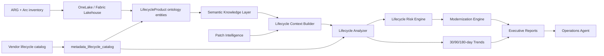

# Operating System Lifecycle Intelligence

## Scope and trust boundary

This phase is read-only. It analyzes governed ARG/Arc inventory, Metadata Lakehouse lifecycle records, Fabric Ontology relationships, Semantic Knowledge Layer context, and Patch Intelligence posture. It does not call Azure from the intelligence package, execute upgrades, create changes, or modify workloads.

Vendor lifecycle pages remain authoritative. The packaged catalog is a versioned seed; operators can replace it with a governed JSON catalog through `fabric.lifecycle.catalog_path`. Each entry carries its source URL and catalog update date.

The seed covers Windows Server, SQL Server, Ubuntu LTS, Red Hat Enterprise Linux, Debian, Azure Stack HCI, Azure Local rolling releases, and Kubernetes 1.29–1.36. Known enterprise product families require an approved vendor documentation domain. Month-only vendor dates and rolling support windows are converted to explicit operational dates only when the catalog note records the convention; paid support tiers are not assumed.

Public subscription rollups retain governed display names. If only a UUID or ARM-style subscription identifier is available, lifecycle output replaces it with a deterministic non-reversible alias; raw subscription identifiers never cross the Operations Agent boundary.

Public findings, queries, reports, and nested collections are bounded before serialization, enforce a 1 MB response ceiling by default, and recursively sanitize literal or encoded ARM/GUID identifiers.

Fabric history correlation remains keyed by canonical lowercase resource ID internally, so duplicate display names cannot merge or overwrite observations. Every history row requires both `resource_key` and `ingestion_run_id`. Trend snapshots are deterministically ordered and separated by `(observed_at, ingestion_run_id)`; synchronized observations use microsecond timestamps.

Unknown patch posture remains `null`/Unknown and contributes zero patch-noncompliance points. Only explicit compliant or failed/noncompliant Semantic/Patch Intelligence evidence affects the patch factor; the engine never invents a midpoint score.

## Architecture



Interactive artifact: `docs/lifecycle-intelligence-architecture.html`.

## Workflow

1. ARG and Arc inventory supplies resource type, OS/product/version, location, and tags.
2. The configured or packaged catalog is validated and persisted to `metadata_lifecycle_catalog`.
3. Each catalog record is published as a `LifecycleProduct` ontology metadata entity.
4. Semantic APIs resolve application, business service, owner, support team, environment, criticality, and patch posture.
5. `EOLCatalog` performs exact normalized product/version matching. Missing matches remain `Unknown`.
6. Configurable thresholds classify Supported, Approaching EOL, Near EOL, Critical, Expired, or Unknown. The compatibility field `lifecycle_status` retains `EOL`; the canonical `lifecycle_classification` field reports `Expired`.
7. Risk, modernization priority, business exposure, trends, and executive reports are generated.
8. The Operations Agent exposes the fixed `Enterprise` / `LifecyclePortfolio` command contract.

## Classification model

Default thresholds:

| Status | Remaining support |
|---|---:|
| Supported | 24+ months |
| Approaching EOL | 12–24 months |
| Near EOL | 6–12 months |
| Critical | 0–6 months |
| Expired (`lifecycle_status=EOL`) | support date passed |
| Unknown | no authoritative product/version match |

The selected support date is explicit: `mainstream` uses mainstream support end; `extended` uses extended support end. Each catalog entry declares a conservative default support channel. Windows Server, SQL Server, Debian LTS, and Kubernetes maintenance use their cataloged extended date by default; paid Ubuntu ESM and RHEL ELS are never assumed. A governed resource `support_channel` override takes precedence.

Thresholds use calendar-month arithmetic rather than average day approximations, so month-end and leap-year boundaries remain deterministic.

## Lifecycle risk model

| Factor | Maximum points |
|---|---:|
| Support timeline | 40 |
| Patch noncompliance | 15 |
| External exposure | 15 |
| Business criticality | 15 |
| Ownership gap | 10 |
| Production environment | 5 |
| Missing catalog match | 15 |

The bounded score maps to Low 0–24, Moderate 25–49, High 50–74, and Critical 75–100. Every finding returns the full factor map and risk drivers.

## Modernization prioritization

- Priority 1: risk 75–100
- Priority 2: risk 50–74
- Priority 3: risk 25–49
- Priority 4: risk 0–24

Recommendations include impact, estimated risk reduction, complexity estimate and basis, evidence, lifecycle status, confidence, risk drivers, and advisory-only action. Risk reduction is limited to the currently assigned support-timeline points; the model does not claim that business criticality, exposure, ownership, environment, or patch risk disappears after an upgrade. Unknown products receive a validation recommendation, never an invented upgrade target.

## Exposure analytics

Rollups are generated by subscription, business service, environment, application, region, and operating system. Portfolio metrics include EOL assets, assets within 12 months, assets without an authoritative upgrade plan, business services at risk, and lifecycle debt score.

## Reports

- Executive Lifecycle Summary
- Modernization Exposure Report
- Business Risk Report
- Application Risk Report
- Technology Debt Report
- Executive Modernization Brief

Example:

```json
{
  "headline": "2 EOL assets; 3 business services at risk; 3 high-risk modernization candidates.",
  "total_eol_assets": 2,
  "assets_with_no_upgrade_plan": 1,
  "lifecycle_debt_score": 250,
  "read_only": true
}
```

Example modernization candidate:

```json
{
  "resource": "vm-payroll-legacy",
  "application": "Payroll",
  "business_service": "Finance Operations",
  "lifecycle_status": "EOL",
  "risk_score": 84,
  "priority": "Priority 1",
  "recommended_action": "Upgrade to Windows Server 2025",
  "complexity_estimate": "High",
  "advisory_only": true
}
```

## Telemetry

- `lifecycle.analysis.duration`
- `lifecycle.catalog.freshness`
- `lifecycle.risk.calculation.latency`
- `lifecycle.business_impact.correlation.latency`
- `lifecycle.executive_report.generation.duration`

Metrics contain no resource names, IDs, evidence text, or recommendations.

Telemetry objects expose both the established instrument attributes and descriptive aliases: `risk_calculation_latency`, `impact_correlation_latency`, and `report_generation_duration`.
