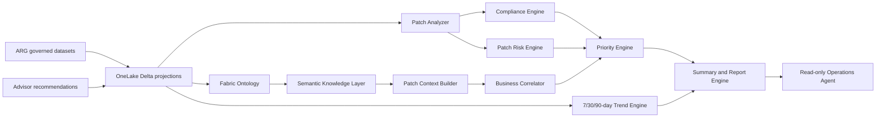

# Patch and Vulnerability Intelligence

## Scope and boundary

This slice adds read-only, business-aware patch intelligence. Azure remains authoritative, OneLake Delta remains the persisted evidence boundary, Fabric Ontology supplies relationships, and the Semantic Knowledge Layer supplies agent-safe context. The engine never calls Azure and never executes remediation, deployment, or change-management actions.

Sources: ARG `PatchAssessmentResources`, ARG `PatchInstallationResources`, Advisor recommendations, governed security findings, Operational Context Graph relationships, Fabric Ontology, and Semantic Knowledge Layer projections.

## Architecture



Interactive architecture artifact: `docs/patch-intelligence-architecture.html`.

## Workflow

1. ARG ingestion filters assessment summaries and installation software-patch rows independently.
2. Normalization creates `PatchAssessment` and `PatchInstallation` evidence with canonical target links.
3. OneLake persists bronze evidence and silver compliance/installation projections.
4. Fabric Ontology links patch evidence to resources; semantic context links resources to applications, business services, owners, support teams, environments, and subscriptions.
5. `PatchAnalyzer` computes resource compliance, risk, priority, and explainability.
6. `PatchTrendEngine` evaluates 7-, 30-, and 90-day windows.
7. `PatchSummaryEngine` ranks applications, subscriptions, and business services and creates executive reports.
8. Operations Agent commands return advisory-only output.

## Data model

`src/intelligence/patch/patch_intelligence.py` defines typed models for `Update`, `UpdateCategory`, `PatchAssessment`, `PatchInstallation` (`Installation`), `MissingUpdate`, `InstalledUpdate`, `FailedUpdate`, `CriticalUpdate`, `SecurityUpdate`, `ResourceCompliance`, `PatchWindow` (`MaintenanceWindow`), `PatchPolicy` (`Policy`), and `PatchBaseline`. Direct constructors reject Boolean counts/scores, negative counts, malformed percentages, and invalid policy thresholds.

## Compliance model

Resource compliance starts at 100 and applies bounded evidence-backed deductions:

| Factor | Deduction |
|---|---:|
| Missing critical update | 20 each, max 40 |
| Missing security update | 10 each, max 30 |
| Failed installation | 10 each, max 20 |
| Patch age over 30 days | 5 per additional 10 days, max 20 |
| Noncompliant state without detailed counts | 25 |
| Missing/unknown assessment evidence | score capped at 40; state remains unknown |

The score is clamped to 0-100. Rollups use the arithmetic mean of resource scores and retain totals for unpatched resources, missing critical/security updates, patch success percentage, patch failure percentage, and the highest observed risk level. Rollups are emitted for resource, subscription, application, business service, and environment. Unknown is not treated as compliant, failed, or unpatched; evidence coverage is reported explicitly.

## Patch risk scoring model

The deterministic risk score is the bounded sum of factor points:

| Factor | Maximum |
|---|---:|
| Business criticality | 20 |
| Application impact | 15 |
| Patch age | 15 |
| Highest patch severity | 20 |
| Missing critical patches | 15 |
| Security findings | 10 |
| Advisor recommendations | 5 |
| Ownership gap | 5 |
| Missing/partial patch evidence | 25 |

Levels: Low 0-24, Moderate 25-49, High 50-74, Critical 75-100. Every finding returns the factor map and textual justification.

## Prioritization methodology

- Priority 1: risk >= 75, or a critical business workload with a missing critical update.
- Priority 2: risk 50-74.
- Priority 3: risk 25-49.
- Priority 4: risk 0-24.

Ordering is priority, descending risk, then resource name. Rationale includes risk score, compliance score, missing critical updates, business criticality, and ownership gaps. Recommended actions explicitly require the approved change process and execute nothing.

## Supported intelligence queries

- Show patch compliance
- Show patch risk
- Show vulnerable applications
- Show critical patch failures
- Show patch priority list
- Show security exposure
- Show patch trends
- Show business impact
- Show patch debt

## Agent commands

- Analyze Patch Compliance
- Analyze Security Exposure
- Show Security Exposure
- Show Critical Patch Failures
- Show High Risk Applications
- Show Business Risk
- Generate Patch Report
- Generate Executive Brief
- Executive Brief
- Show Priority Remediation Candidates

Patch commands are restricted to the pre-authorized `Enterprise` / `PatchPortfolio` scope. Other subject labels or types fail closed instead of silently returning portfolio-wide data.

## Explainability contract

Every resource finding contains resource, application, owner, support team, business service, compliance score, risk score, business impact, recommended action, evidence, affected resources, risk justification, priority reasoning, confidence score, and `advisory_only=true`.

All public findings, reports, query results, and Operations Agent payloads recursively sanitize literal and encoded ARM IDs, tenant/subscription identifiers, standalone GUIDs, and reversible percent/Base64/hex/Unicode-escape representations. Collections are capped before serialization, qualifying counts are calculated before truncation, truncated nested collections carry count/returned/truncated metadata, and the default serialized response ceiling is 1 MB. Exceeding the byte ceiling fails closed.

## Example reports

Executive Patch Summary:

```json
{
  "headline": "1 Priority 1 workload(s); 1 exposed resource(s); overall compliance 63.33.",
  "priority_remediation_candidates": [
    {
      "resource": {"name": "vm-payroll-01", "entity_type": "VirtualMachine"},
      "application": "Payroll",
      "business_service": "HR Services",
      "priority": "Priority 1",
      "business_impact": "Critical",
      "advisory_only": true
    }
  ],
  "read_only": true
}
```

Business impact chain:

```text
vm-payroll-01 patch failure
  -> Payroll application
  -> HR Services business service
  -> hr-platform@example.com
  -> HR Operations
Impact: Critical
```

## Telemetry

- `patch.compliance.calculation.duration`
- `patch.intelligence.analysis.latency`
- `patch.trend.calculation.latency`
- `patch.intelligence.freshness`
- `patch.risk.calculation.duration`
- `patch.business_impact.correlation.duration`

Metric dimensions must remain low-cardinality and must not include resource IDs, names, findings, or recommendation text.
