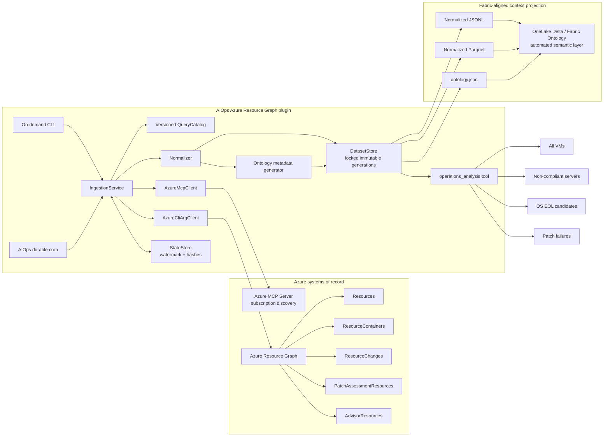

# Architecture

## Design boundaries

- Azure remains the inventory and operational system of record.
- Azure MCP performs supported subscription discovery. The tested Azure MCP build does not expose an arbitrary ARG query tool, so the connector uses the existing Azure CLI `az graph query` command for the five required tables instead of adding an Azure SDK wrapper.
- ARG CLI and REST acquisition follows continuation tokens within the configured page budget. Explicit truncation without a usable continuation token fails as incomplete paging, never as a complete empty or partial source. Malformed truncation or continuation metadata also fails closed; semantic query limits do not bound the entire inventory acquisition.
- AIOps cron provides durable scheduling; the connector does not introduce another scheduler.
- Normalized entities, relationships, and generated ontology metadata are separate datasets; raw query retention is an explicit, disabled-by-default option.
- OneLake Delta is canonical persistence. Typed graph projections are bound through the documented Fabric Ontology public-definition REST API; no custom graph store or undocumented instance-write API is used.
- Dataset generations use owner-only permissions and an atomic `current` symlink switch. A cross-process lock prevents concurrent writers.
- `ResourceChanges` uses a maximum-observed watermark, overlap window, and accumulated deduplicated history.
- Five ARG queries run in parallel after Azure MCP discovery so the default job remains within AIOps cron's execution budget.
