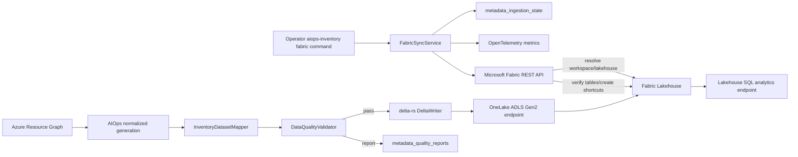

# Fabric OneLake Persistence Architecture

The Lakehouse persistence layer feeds the Fabric-native Operational Context Graph described in [ontology-architecture.md](ontology-architecture.md). Typed entity and relationship Delta projections are bound to Microsoft Fabric Ontology through Fabric's public definition API; no custom graph database is introduced.

## Component responsibilities

- `fabric.auth`: service-principal and managed-identity credentials. Secrets are read from environment variables, never YAML.
- `fabric.fabric_client`: authenticated Fabric REST requests, continuation tokens, long-running operations, and bounded transient retries.
- `fabric.workspace_manager` and `fabric.lakehouse_manager`: deterministic workspace/lakehouse selection, optional lakehouse creation, shortcut creation, and Delta registration verification.
- `storage.onelake_writer`: standard `Files/` directory creation, metadata files, and canonical `Tables/` URIs.
- `storage.delta_writer`: Delta overwrite, append, and merge/upsert using optimistic Delta transactions, retry, and per-run idempotency.
- `fabric.sync_service`: source-generation selection, replay, validation, Bronze/Silver/Ontology writes, state transitions, catalog generation, registration, and metrics.

OneLake is accessed through its ADLS Gen2-compatible endpoint; the implementation uses the Microsoft Azure Data Lake Storage SDK for folders/files and delta-rs for Delta transactions.[1] Fabric workspace, Lakehouse, table, and shortcut operations follow the published Fabric REST API specification.[2]

## Security boundaries

- Fabric API token scope: `https://api.fabric.microsoft.com/.default`.
- OneLake token scope: `https://storage.azure.com/.default`.
- The service-principal secret is loaded from `FABRIC_CLIENT_SECRET` or another configured environment variable.
- Managed identity can be system-assigned or user-assigned.
- Source snapshots and configuration paths are resolved and containment-checked.
- Agent calls cannot supply credentials, workspace IDs, Lakehouse IDs, or filesystem roots.

### Automated readiness probe (source-only)

`fabric.gql_readiness.GqlReadinessProbe` provides an unactivated observation
building block for future maintenance. Trusted server composition supplies
the workspace, graph, credential and HTTP client; invocation accepts no target
or query. It sends only `RETURN 1 AS probe LIMIT 1` to the documented beta
endpoint and requires the exact complete scalar result.

The probe defaults to a 30-second acceptance deadline and four requests
(configuration ceilings: 60 seconds and ten requests). All responses combined
are limited to 64 KiB. Continuations keep the query and destination unchanged,
encode opaque tokens once, and never count a pending response as success.
Transport/HTTP errors, execution errors, warnings including truncation, malformed
results and late results raise explicit errors without raw service text.
No transport retry, redirect, graph refresh, configuration write or load occurs.
Credential acquisition and blocking HTTP phases are checked against elapsed
time, but cannot be forcibly interrupted by the acceptance deadline; no late
result is accepted as ready.

This probe is not registered in runtime or a scheduler. Passing it proves only
that the configured graph endpoint can execute the constant query for that
credential. It does not prove entity/edge membership, source freshness, tenant
isolation for other callers, automatic refresh or unattended ontology authoring.
Those qualification and admission gates remain mandatory before recurrence.

### Regenerated exposure-to-registry mapping

Inventory dataset mapping emits
`ontology_rel_exposes_container_image_exposure_container_registry` through
the shared ontology relationship builder. Each row joins the exposure's
`resource_id` (`subject_id`) to its explicitly declared `registryResourceId`
or `registry_resource_id` (`object_id`). The target must already exist as a
`ContainerRegistry` entity. Missing bindings, absent registries and targets of
other types produce no edge; registry hostnames, image paths and generic
`targetResourceId` fields are never used to infer the binding.

The relationship participates in the authoritative vocabulary, aggregate
ontology relationships, typed mapping table and normal graph validation.
Stable identities and semantic versions survive ingestion retries. Source
generation does not itself update a native definition or refresh its graph;
publication and supported materialization remain separately governed.

The sync-to-publisher contract includes this typed table even when it has no
active rows. The existing **legacy JSON** definition generator binds
`subject_id` to the exposure's `resource_id` property and `object_id` to the
registry's `resource_id` property in its relationship contextualization.
This is not a serializer for the current native TMDL definition or a
Configure Graph automation interface. The legacy publisher must continue
rejecting native TMDL targets before any write; reproducing the supported
native mapping-table rebind and Manage graph selection remains a separate,
unqualified authoring step.

`fabric.ontology.native_registry_mapping` provides a separate, pure publication-boundary
projection for this fixed table's native two-column contract. Given complete
active typed relationships, exposures and registries, it requires exact parity
with explicit `registry_resource_id` bindings and same-tenant endpoints, rejects
duplicate identities or pairs, and returns deterministic `subject_id` /
`object_id` rows with a two-nullable-string-column Arrow schema. Explicit empty
registry bindings produce no pair; missing or malformed bindings fail closed.
It does not change the generic relationship schema or aggregate graph metadata.
The helper alone does not activate publication: the caller must retain source
scope, collapse guards, leases, version checks, transaction reconciliation and
rollback, and hash the actual persisted pair payload. Empty output is not
authority to clear a live table, and projection parity is not source freshness.

## Sources

[1] Microsoft, “OneLake access APIs.” https://learn.microsoft.com/en-us/fabric/onelake/onelake-access-api

[2] Microsoft, “Fabric REST API specifications.” https://github.com/microsoft/fabric-rest-api-specs
