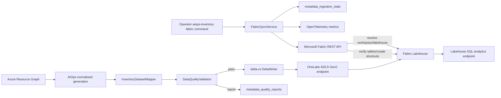

# Fabric OneLake Persistence Architecture

The Lakehouse persistence layer feeds the Fabric-native Operational Context Graph described in [ontology-architecture.md](ontology-architecture.md). Typed entity and relationship Delta projections are bound to Microsoft Fabric Ontology through Fabric's public definition API; no custom graph database is introduced.

## Component responsibilities

- `fabric.auth`: service-principal and managed-identity credentials. Secrets are read from environment variables, never YAML.
- `fabric.fabric_client`: authenticated Fabric REST requests, continuation tokens, long-running operations, and bounded transient retries.
- `fabric.workspace_manager` and `fabric.lakehouse_manager`: deterministic workspace/lakehouse selection, optional lakehouse creation, shortcut creation, and Delta registration verification.
- `storage.onelake_writer`: standard `Files/` directory creation, metadata files, and canonical `Tables/` URIs.
- `storage.delta_writer`: Delta overwrite, append, and merge/upsert using optimistic Delta transactions, retry, and per-run idempotency.
- `fabric.sync_service`: source-generation selection, replay, validation, Bronze/Silver/Ontology writes, state transitions, catalog generation, registration, and metrics.

OneLake is accessed through its ADLS Gen2-compatible endpoint; the implementation uses the Microsoft Azure Data Lake Storage SDK for folders/files and delta-rs for Delta transactions.[1] Fabric workspace, Lakehouse, table, and shortcut operations follow the published Fabric REST API specification.[2]

## Security boundaries

- Fabric API token scope: `https://api.fabric.microsoft.com/.default`.
- OneLake token scope: `https://storage.azure.com/.default`.
- The service-principal secret is loaded from `FABRIC_CLIENT_SECRET` or another configured environment variable.
- Managed identity can be system-assigned or user-assigned.
- Source snapshots and configuration paths are resolved and containment-checked.
- Agent calls cannot supply credentials, workspace IDs, Lakehouse IDs, or filesystem roots.

## Sources

[1] Microsoft, “OneLake access APIs.” https://learn.microsoft.com/en-us/fabric/onelake/onelake-access-api

[2] Microsoft, “Fabric REST API specifications.” https://github.com/microsoft/fabric-rest-api-specs
