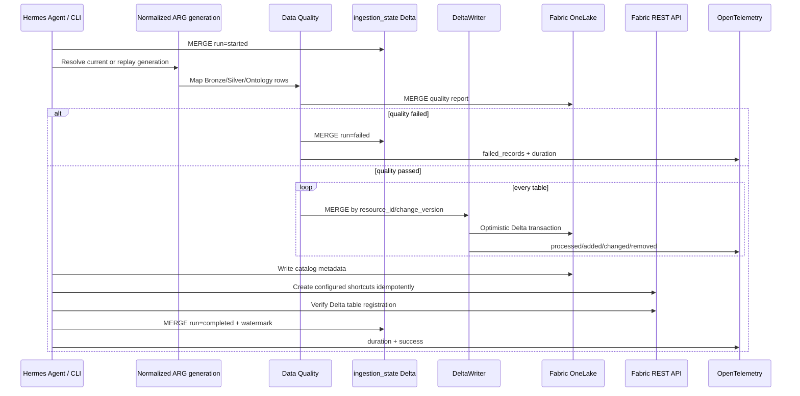

# Fabric Inventory Data Flow



## Standard Lakehouse layout

```text
Files/
├── bronze/
│   ├── resources/
│   ├── subscriptions/
│   ├── resourcegroups/
│   ├── advisor/
│   └── patchassessment/
├── silver/
│   ├── vm_inventory/
│   ├── server_inventory/
│   ├── compliance/
│   └── resource_relationships/
├── ontology/
│   ├── entities/
│   ├── relationships/
│   └── metadata/catalog.json
└── metadata/
    ├── ingestion_state/
    └── quality_reports/

Tables/
├── bronze_resources
├── bronze_subscriptions
├── bronze_resourcegroups
├── bronze_advisor
├── bronze_patchassessment
├── bronze_resource_changes
├── silver_vm_inventory
├── silver_server_inventory
├── silver_compliance
├── silver_resource_relationships
├── ontology_entities
├── ontology_relationships
├── metadata_ingestion_state
└── metadata_quality_reports
```

Folders provide the requested medallion organization. Queryable Delta tables live in the Lakehouse `Tables` area with layer-prefixed names. `table_schema` optionally places them under `Tables/<schema>/`. Fabric automatically discovers valid Delta tables written under `Tables`; the sync verifies visibility through the Lakehouse tables REST endpoint before marking a cloud run complete.[1] This cloud registration path remains unverified in the current credential-free environment.

Current-state tables use idempotent full-snapshot overwrite, so resources absent from the latest authoritative ARG generation are removed. The ResourceChanges feed uses merge/upsert. Failures before catalog/registration commit trigger best-effort Delta rollback. After that publication boundary, tables are retained and a failed state is recorded for idempotent Ontology/shortcut retry, preventing an externally published definition from referencing rolled-back data.

Every business table contains:

- `tenant_id`
- `subscription_id`
- `resource_id`
- `timestamp`
- `change_version`
- `ingestion_run_id`

## Sources

[1] Microsoft, “Fabric REST API specifications — Lakehouse.” https://github.com/microsoft/fabric-rest-api-specs/tree/main/lakehouse
