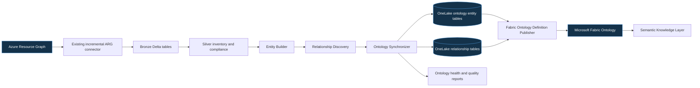

# Operational Context Graph architecture

Standalone architecture, ontology, and traversal diagrams are available in [operational-context-graph-architecture.html](operational-context-graph-architecture.html).

## Authoritative boundaries

- Azure Resource Graph is authoritative for Azure inventory and resource-change observations.
- OneLake Delta tables are the canonical governed persistence layer.
- Microsoft Fabric Ontology is the authoritative semantic layer. Hermes does not implement a graph database.
- Cosmos DB is not used; the implementation has no supplemental state requirement that OneLake Delta state cannot satisfy.



## Continuous update sequence

```mermaid
sequenceDiagram
  participant ARG as Azure Resource Graph
  participant H as Hermes sync
  participant OL as OneLake Delta
  participant F as Fabric REST API
  participant O as Fabric Ontology
  ARG->>H: Authoritative snapshot + ResourceChanges
  H->>H: Generate entities and infer relationships
  H->>OL: Overwrite current graph; preserve retired records
  H->>OL: Write lineage, version, health, quality
  H->>F: Verify Lakehouse table registration
  H->>F: Create or update Ontology public definition
  F->>O: Bind entity and relationship types to Lakehouse tables
  H->>OL: Commit completed ingestion state
```

A run holds the existing OneLake lease. Table-write or pre-publication registration failures restore prior Delta versions. Once catalog/registration commit establishes the publication boundary, graph tables are retained across Ontology/shortcut failures and failed state directs an idempotent retry; this prevents an external definition from referencing rolled-back data.

The agent-facing layer above this graph is the [Semantic Knowledge Layer](semantic-architecture.md). It is the only registered agent retrieval interface and prevents agents from querying Azure projections, Delta tables, or raw Ontology traversals directly.

## Incremental semantics

- Deterministic entity IDs are tenant-scoped.
- Deterministic relationship IDs hash source, predicate, and target.
- `change_version` fingerprints semantic content rather than ingestion time.
- Removed entities and relationships are retained with `lifecycle_status=retired`, `retired_at`, and `ontology_version`.
- Entity/relationship Delta tables are authoritative snapshot overwrites; historical Azure ResourceChanges remains a merge table.
- Fabric Ontology definitions use stable positive 64-bit IDs and UUIDv5 binding IDs. An unchanged definition is not republished.
- Synchronization validates canonical identities and endpoints before publishing, preserves `valid_from` for updates, and fails closed on malformed or dangling graph records.

## Source references

- [Fabric Ontology public definition](https://learn.microsoft.com/en-us/rest/api/fabric/articles/item-management/definitions/ontology-definition)
- [Fabric REST API specifications](https://github.com/microsoft/fabric-rest-api-specs/tree/main/ontology)
