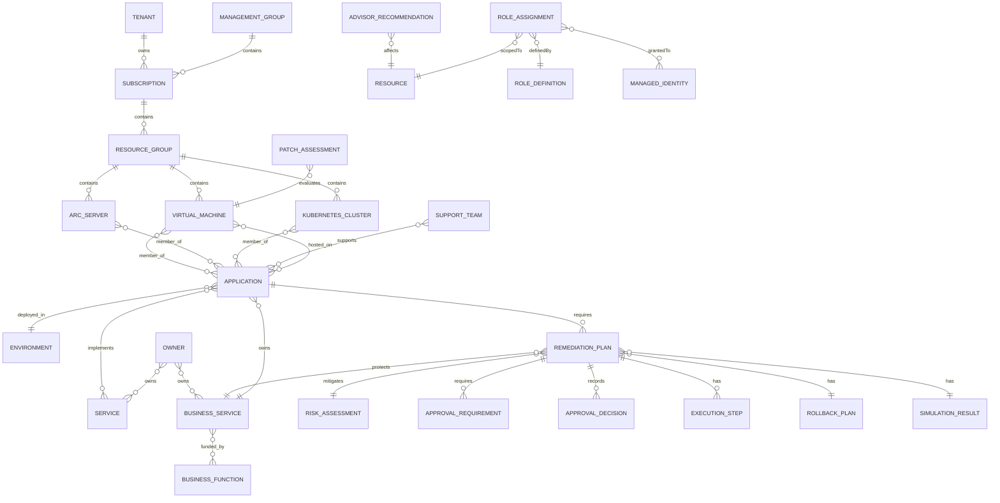

# Operational Context Graph model

## Entity relationship diagram

The implementation also retains a generic `Resource` entity for Azure resource types without a specialized class.

## Tag intelligence

Tag names are matched case-insensitively. Values are never enumerated or hardcoded.

| Tag | Generated entity | Generated context |
|---|---|---|
| `AppName`, `Application` | Application | resource `member_of` application; application `hosted_on` resource |
| `Environment` | Environment | application `deployed_in` environment |
| `BusinessUnit`, `BusinessService` | Business Service | business service `owns` application (with compatibility `contains` edge); resource `belongs_to` business service |
| `CostCenter` | Business Function | business service `funded_by` business function |
| `Owner` | Owner | resource `owned_by` owner; owner `owns` service/business service |
| `SupportGroup`, `SupportTeam` | Support Team | support team `supports` application |
| `Service`, `ServiceName` | Service | application `implements` service; resource `provides` service |
| `DependsOn`, `Dependencies`, `ApplicationDependencies` | Application | source application `depends_on` each comma/semicolon-delimited application |

Every inferred entity stores `lineage_json`, semantic discovery metadata, source IDs, lifecycle state, and version.

## Fabric table bindings

Fabric Ontology cannot apply an entity-type row filter to one mixed table. Therefore the publisher binds each entity type to a typed Lakehouse projection such as:

- `ontology_virtual_machine_entities`
- `ontology_application_entities`
- `ontology_business_service_entities`
- `ontology_role_assignment_entities`
- `ontology_role_definition_entities`
- `ontology_managed_identity_entities`

Each concrete relationship type/pair uses a separate contextualization table, for example:

- `ontology_rel_hosted_on_application_virtual_machine`
- `ontology_rel_supports_support_team_application`

The generic `ontology_entities` and `ontology_relationships` tables remain canonical traversal and lineage projections.

## Graph traversal examples

- VM ownership: `VirtualMachine --owned_by--> Owner`.
- Application membership: `VirtualMachine --member_of--> Application`.
- Service resources: `Service <--implements-- Application --hosted_on--> Resource`.
- Patch impact: `PatchAssessment --evaluates--> Server --member_of--> Application`.
- Server blast radius: `Server --member_of--> Application <--depends_on-- dependent Application <--owns-- BusinessService`.
- Business ownership: `BusinessService --owns--> Application --hosted_on--> Infrastructure`.
- Remediation readiness: `Application --requiresPlan--> RemediationPlan --requiresApproval--> ApprovalRequirement`.
- Remediation decision audit: `RemediationPlan --hasApprovalDecision--> ApprovalDecision`.
- Remediation safety: `RemediationPlan --hasStep--> ExecutionStep`, `--hasRollbackPlan--> RollbackPlan`, and `--hasSimulation--> SimulationResult`.
- Business risk reduction: `RemediationPlan --mitigatesRisk--> RiskAssessment` and `--protectsService--> BusinessService`.
- Blast radius of a grant: `RoleAssignment --definedBy--> RoleDefinition` (privilege check) combined with `RoleAssignment --scopedTo--> Resource` (reach), grouped by `principalId`.

Traversals use canonical case-insensitive identities, active relationships only, cycle detection, and configured node/result limits. Agents consume the bounded Semantic Layer projection rather than these raw paths.

## Context views

- Application context: applications, hosting resources, services, environments, owners, and support teams.
- Infrastructure context: subscriptions, resource groups, resources, compliance assessments, and recommendations.
- Subscription context: subscription hierarchy, resource groups, Arc-managed assets, and governance context.
- Compliance context: patch assessments, Advisor recommendations, evaluated resources, and affected applications.
- Business context: business services, applications, services, owners, business functions, and infrastructure.
- Remediation context: draft remediation plans, required approvals, approval/rejection/expiry decisions, ordered execution steps, rollback plans, simulation results, mitigated risks, protected business services, and linked applications.
- Identity context: role assignments, role definitions, managed identities, and the principals/resources they connect — the source for the Identity page's access-governance views.
