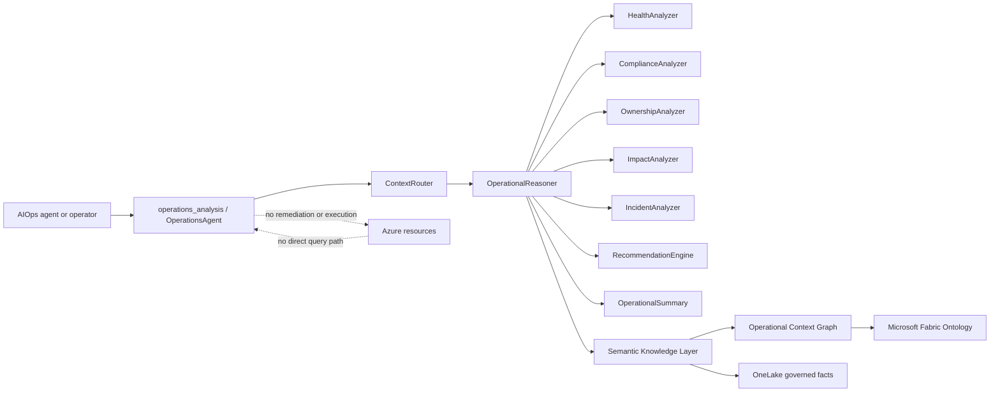
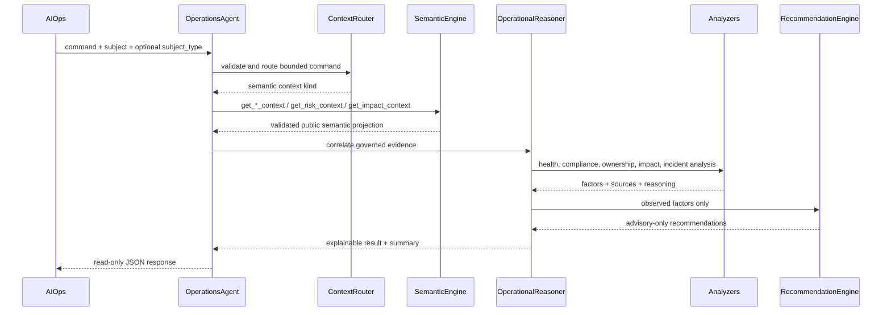
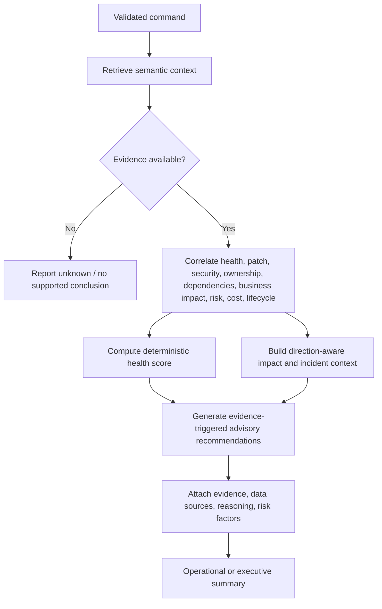

# Operations Agent Architecture

## Scope and safety boundary

The Operations Agent is the primary agent-facing operational reasoning interface. It performs deterministic analysis, correlation, health scoring, incident-context assembly, summarization, and advisory recommendation generation. It has no execution, mutation, remediation, Azure SDK, Azure MCP, Azure CLI, Delta, or raw Ontology query capability.

The agent receives only validated public projections from `SemanticEngine`. Consequently it continues to operate from Fabric/OneLake state while Azure is unavailable.

The stable public package is `src/operations/`; its ten requested modules expose the implementation maintained under `src/agents/operations/` without duplicating reasoning logic.

For resource, service, subscription, and environment analysis, the reasoner correlates related public Semantic contexts—resource to application, application to dependencies/services/business services, and aggregate subjects to constituent workloads. Correlation is capped at 50 supporting rows per collection, preserves section truncation metadata, and never accesses `SemanticEngine.indexes` or raw records.

## Architecture diagram

Interactive standalone artifact: `docs/operations-agent-core-architecture.html`.



## Agent workflow diagram



## Reasoning flow



## Supported commands

| Command | Primary output |
|---|---|
| Analyze VM | Resource health, patch/security/ownership/risk reasoning and recommendations |
| Analyze Application | Application topology, health, risk, governance, cost/lifecycle context |
| Analyze Subscription | Subscription resource health, compliance, cost, and risk summary |
| Analyze Business Service | Application/service composition, dependencies, risk, and health |
| Show Operational Risk | Explainable Semantic Layer risk factors (`Analyze Operational Risk` remains compatible) |
| Show Patch Compliance | Severity, application/business impact, escalation context, advisory next steps (`Analyze Patch Compliance` remains compatible) |
| Show Health Summary | VM, application, service, subscription, business-service, or environment health |
| Show Impact Summary | Upstream/downstream dependencies, blast radius, criticality, business impact |
| Executive Summary | Condensed risk, findings, and prioritized advisory actions (`Generate Executive Summary` remains compatible) |
| Generate Incident Context | Incident-ready impact, ownership, patch, advisor, risk, and dependency context |

## Health scoring model

Health begins at 100. Only observed evidence causes deductions:

| Observed factor | Maximum deduction |
|---|---:|
| Explainable operational risk | 40 |
| Unhealthy/degraded runtime state | 25 |
| Confirmed patch noncompliance | 15 |
| Security findings | 20 |
| Confirmed missing ownership | 10 |
| Limited evidence coverage | 40 |
| Partial evidence coverage | 10 |

The result is clamped to 0–100.

| Score | Category |
|---:|---|
| 80–100 | Healthy |
| 60–79 | Warning |
| 40–59 | Degraded |
| 0–39 | Critical |

Unknown domain facts do not create domain-specific deductions. To avoid reporting an unsupported Healthy result, incomplete evidence applies a separate deterministic uncertainty deduction: 40 for Limited coverage and 10 for Partial coverage. Missing domains are listed in `unknowns`; the score is therefore a conservative operational posture, not a claim that an unobserved component is unhealthy.

## Recommendation examples

```json
{
  "priority": "High",
  "impact": "Reduces exposure from confirmed patch noncompliance.",
  "confidence": 1.0,
  "rationale": "Patch evidence reports failed with 2 failed patches.",
  "suggested_action": "Review failed patches and schedule remediation through the approved change process.",
  "evidence": ["patch_noncompliance"],
  "advisory_only": true
}
```

Other evidence-triggered examples include assigning missing ownership, initiating immediate review of a critical-risk workload, validating security findings, reviewing governed cost context, and planning modernization for an obsolete lifecycle state. The agent never executes these actions.

Governed governance findings also produce a Medium-priority advisory review with evidence, rationale, confidence, impact, and an approved corrective-action suggestion.

## Explicit reasoning workflows

- `analyze_patch_failure`: correlates patch posture with resource risk, application/business-service impact, ownership, and approved next-step advice.
- `analyze_ownership`: returns governed owner, support, escalation, and business-service coverage.
- `analyze_dependencies`: returns direction-aware upstream/downstream dependencies, blast radius, and business impact.
- `analyze_risk`: returns the Semantic Layer risk score, level, factors, freshness, and version without querying Azure.

## Incident analysis example

A VM incident response contains:

- impacted applications, services, and business services;
- owners and support teams;
- direction-aware dependency tree and blast radius;
- current risk factors and health posture;
- patch status, Advisor findings, and security findings;
- an affected-user estimate only when governed evidence exists; otherwise an explicit unavailable result;
- evidence metadata, freshness, and opaque knowledge version.

## Explainability contract

Every conclusion contains `evidence`, `data_sources`, `reasoning`, and `risk_factors`. Every recommendation contains `priority`, `impact`, `confidence`, `rationale`, `suggested_action`, `evidence`, and `advisory_only=true`.

Public outputs do not include tenant/subscription/resource IDs, ingestion/source run IDs, raw payloads, lineage, semantic metadata, or caller-reflected raw identifiers.

Public strings are recursively sanitized for literal and encoded ARM/GUID identifiers. Collections default to 100 returned items with truncation metadata, and the default serialized response ceiling is 1 MB. Missing risk remains `Unknown`, never `Low`.
