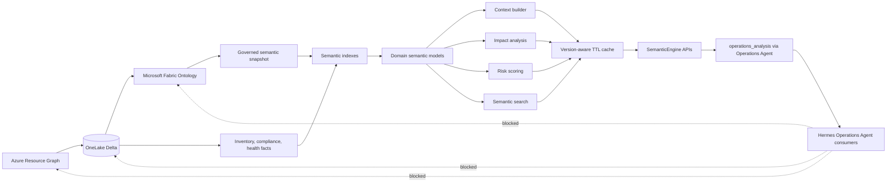
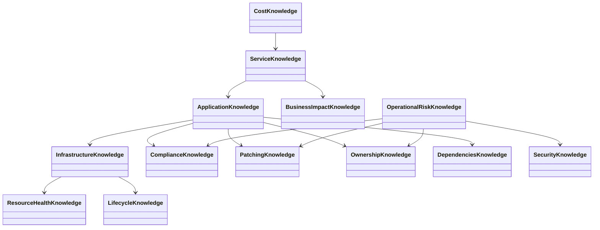
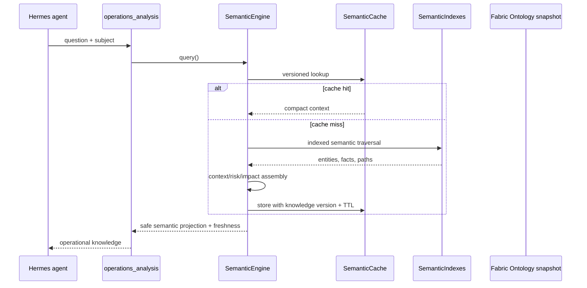

# Semantic Knowledge Layer architecture

The Semantic Knowledge Layer is the sole read-only operational knowledge interface exposed to future Hermes agents. Microsoft Fabric Ontology remains authoritative for entities and relationships; OneLake remains canonical persistence. The layer builds ephemeral indexes and bounded caches, not another database.

The public framework uses the exact modules `semantic_engine`, `semantic_registry`, `semantic_models`, `query_cache`, `indexes`, and `validator`. Compatibility implementations remain in the established `semantic_cache`, `semantic_indexes`, and `semantic_validator` modules without duplicating state.

Standalone architecture artifact: `docs/semantic-knowledge-layer-architecture.html`.

The plugin no longer registers raw Semantic, Azure, Ontology, or Fabric mutation/status tools. Agents receive only `operations_analysis`; it consumes the Semantic Layer internally while Fabric synchronization remains separate operator CLI/API functionality.

## Semantic model diagram

All models are registered in `SemanticRegistry` with their required Ontology and operational-fact sources.

## Query flow

## Data and security boundaries

- Raw Azure payloads, tenant IDs, subscription IDs, lineage, and ingestion IDs never appear in agent responses.
- Internal indexes contain only the current active Ontology snapshot and governed operational facts.
- Cache entries are invalidated by knowledge version and bounded by TTL and LRU capacity.
- No semantic result is persisted as a competing system of record.
- Semantic snapshot validation rejects active dangling relationships before serving knowledge.
- Source collections, traversal nodes/depth, results, cache entries, and serialized public responses are bounded. Public strings and mapping keys redact literal or encoded ARM/GUID identifiers and fail closed on sanitized-key collisions.
- Subjects without resource evidence return `score=null`, `level=Unknown`, and no invented risk factors.

Fabric Ontology definition contract: https://learn.microsoft.com/en-us/rest/api/fabric/articles/item-management/definitions/ontology-definition
